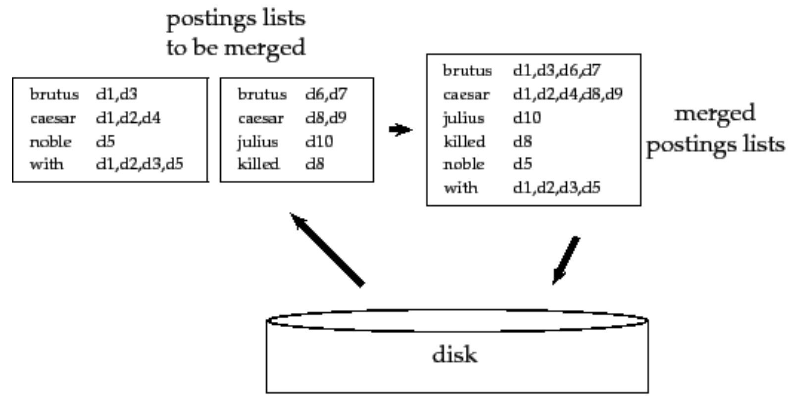

# Blocked Sort-Based Indexing (BSBI)

## 1. Il problema

Per piccole collezioni di documenti si può costruire l'intero [[Inverted Index|indice invertito]] in memoria. Con collezioni reali questo non è possibile: i termini distinti sono troppo numerosi e l'indice non entra in RAM. Serve quindi usare il **disco** come memoria di appoggio.

```ad-note
Stiamo comunque assumendo di riuscire a tenere l'intero indice su disco. Anche questo, in casi estremi, non è garantito.
```

Un primo miglioramento è rappresentare i termini come **termID** numerici invece che come stringhe: più compatti, più veloci da confrontare e ordinare.

Ci sono due strategie per costruire la mappa `termine -> termID`:

- **on the fly**: costruita incrementalmente mentre si processano i documenti;
- **a 2 fasi**: prima si costruisce l'intera mappa, poi si costruisce l'indice.

### Statistiche di esempio — Reuters-RCV1

|Simbolo|Statistica|Valore|
|---|---|---|
|$N$|Numero di documenti|800.000|
|$T_{avg}$|Media token per documento|200|
|$M$|Numero di termini distinti (vocabolario)|400.000|
|$T$|Numero totale di token|100.000.000|
|—|Media byte/token (con punteggiatura)|6|
|—|Media byte/token (senza punteggiatura)|4,5|
|—|Media byte/termine|7,5|

Dato che la RAM non basta, serve un **external sorting algorithm**: un algoritmo di ordinamento che usa il disco come memoria ausiliaria, minimizzando seek e massimizzando gli accessi sequenziali.

## 2. L'algoritmo BSBI

**Blocked Sort-Based Indexing**:

1. Si processano i documenti sequenzialmente, accumulando in memoria un **blocco** di coppie $\langle \text{termID}, \text{docID} \rangle$ — una per ogni occorrenza di token (con eventuali duplicati se un termine compare più volte nello stesso documento). Il numero di coppie totali è pari al numero di **token**.
2. Quando il blocco è pieno, lo si **ordina** per termID (e poi per docID).
3. Si **inverte** il blocco: si raggruppano le coppie con lo stesso termID in $\langle \text{termID}, \text{posting-list} \rangle$. Ora ogni termine appare una sola volta nel blocco.
4. Si **salva su disco** il blocco invertito.
5. Una volta processati tutti i documenti, si **fondono** (merge) i blocchi a coppie, finché non se ne ottiene uno solo: l'indice finale.

```ad-note
Ogni singolo blocco, preso da solo, è già un piccolo indice invertito completo, con termini e posting list ordinati.
```



## 3. Implementazione in Python

```python
from dataclasses import dataclass, field
from pathlib import Path
from typing import Iterator
import json

# --- Dizionario globale termine -> termID -------------------------------

class TermDictionary:
    def __init__(self):
        self._term_to_id: dict[str, int] = {}
        self._next_id = 0

    def get_id(self, term: str) -> int:
        """Restituisce il termID di `term`, assegnandone uno nuovo se necessario."""
        if term not in self._term_to_id:
            self._term_to_id[term] = self._next_id
            self._next_id += 1
        return self._term_to_id[term]

    def __len__(self) -> int:
        return len(self._term_to_id)


# --- Lettura documenti a blocchi ----------------------------------------

@dataclass
class Document:
    path: Path
    doc_id: int

    def read_blocks(self, block_size: int = 1024) -> Iterator[str]:
        """Genera blocchi di testo di al più `block_size` caratteri."""
        with open(self.path, "r", encoding="utf-8") as f:
            while True:
                chunk = f.read(block_size)
                if not chunk:
                    break
                yield chunk


# --- Fase di parsing + sort + invert di un blocco -----------------------

def bsbi_invert_block(text: str, doc_id: int, dictionary: TermDictionary) -> list[tuple[int, list[int]]]:
    """
    Da un blocco di testo produce le coppie (termID, docID),
    le ordina per termID e le inverte in (termID, posting_list).
    """
    # O(B log B) per ordinare (B # di token nel blocco)
    tokens = sorted(text.lower().split()) 

    pairs = [(dictionary.get_id(t), doc_id) for t in tokens]
    pairs.sort(key=lambda p: p[0])  # sort per termID (già quasi ordinato)

    inverted: dict[int, list[int]] = {}
    for term_id, d_id in pairs:
        inverted.setdefault(term_id, []).append(d_id)

    return sorted(inverted.items())


def write_block_to_disk(block: list[tuple[int, list[int]]], out_dir: Path, index: int) -> Path:
    path = out_dir / f"block_{index}.json"
    with open(path, "w", encoding="utf-8") as f:
        json.dump(block, f)
    return path


# --- Costruzione indice completa ----------------------------------------

def bsbi_index_construction(documents: list[Document], out_dir: Path, block_size: int = 1024) -> Path:
    dictionary = TermDictionary()
    out_dir.mkdir(parents=True, exist_ok=True)

    block_files: list[Path] = []
    block_counter = 0

    for document in documents:
        for chunk in document.read_blocks(block_size):
            inverted_block = bsbi_invert_block(chunk, document.doc_id, dictionary)
            path = write_block_to_disk(inverted_block, out_dir, block_counter)
            block_files.append(path)
            block_counter += 1

    return merge_blocks(block_files, out_dir)


# --- Merge dei blocchi (a coppie, come in mergesort) ---------------------

def load_block(path: Path) -> list[tuple[int, list[int]]]:
    with open(path, "r", encoding="utf-8") as f:
        return json.load(f)


def merge_two_blocks(a: list[tuple[int, list[int]]],
                      b: list[tuple[int, list[int]]]) -> list[tuple[int, list[int]]]:
    """
    Merge lineare di due blocchi ordinati per termID.
    Le posting list dello stesso termine vengono concatenate
    (i docID restano ordinati perché assegnati in ordine di arrivo)
    e i duplicati vengono rimossi mantenendo l'ordine.
    """
    i = j = 0
    merged: dict[int, list[int]] = {}

    while i < len(a) and j < len(b):
        term_a, posting_a = a[i]
        term_b, posting_b = b[j]
        if term_a == term_b:
            merged[term_a] = _dedup(posting_a + posting_b)
            i += 1
            j += 1
        elif term_a < term_b:
            merged[term_a] = posting_a
            i += 1
        else:
            merged[term_b] = posting_b
            j += 1

    while i < len(a):
        merged[a[i][0]] = a[i][1]
        i += 1
    while j < len(b):
        merged[b[j][0]] = b[j][1]
        j += 1

    return sorted(merged.items())


def _dedup(sorted_list: list[int]) -> list[int]:
    """Rimozione duplicati in tempo lineare da una lista già ordinata."""
    result = []
    for x in sorted_list:
        if not result or result[-1] != x:
            result.append(x)
    return result


def merge_blocks(block_files: list[Path], out_dir: Path) -> Path:
    """Merge iterativo a coppie finché non resta un solo blocco (l'indice finale)."""
    files = list(block_files)
    round_num = 0

    while len(files) > 1:
        next_round: list[Path] = []
        for k in range(0, len(files), 2):
            if k + 1 < len(files):
                a = load_block(files[k])
                b = load_block(files[k + 1])
                merged = merge_two_blocks(a, b)
            else:
                merged = load_block(files[k])  # blocco spaiato

            path = out_dir / f"merged_r{round_num}_{k // 2}.json"
            with open(path, "w", encoding="utf-8") as f:
                json.dump(merged, f)
            next_round.append(path)

        files = next_round
        round_num += 1

    return files[0]
```

## 4. Analisi Inversione Blocchi

- $N$: Numero totale di blocchi in cui è divisa l'intera collezione.
- $B$: Numero massimo di token (parole) all'interno di un singolo blocco.
- $T$: Numero totale di token elaborati nell'intera collezione (dove $T \approx N \times B$).
- $V$: Dimensione del vocabolario (numero di termini unici).

Questa fase è gestita dalla funzione `bsbi_invert_block`, che viene eseguita $N$ volte (una per ogni blocco). Per un singolo blocco il costo è dominato dagli ordinamenti, quindi $O(B \log B)$.

Essendoci $N$ blocchi, il costo temporale per l'intera fase di inversione è:

$$O(N \cdot B \log B) \implies O(T \log B)$$

## 5. Analisi Merge dei Blocchi e delle Posting

### Merge di due posting list

Se i `docID` vengono assegnati **in ordine di arrivo** dei documenti, allora i `docID` in un blocco $i$ sono sempre $\leq$ quelli nel blocco $i+1$. Questo garantisce che il merge di due posting list dello stesso termine sia una semplice **concatenazione seguita da deduplica lineare**, esattamente come la fase di merge di un mergesort — nessun bisogno di riordinare.

**Esempio**: 
Dati i documenti `docA (id=1), docB (id=2), docC (id=3)` e i termini `term1..term5`.
Supponiamo di avere 4 blocchi costituiti nel seguente modo:

```
Block 1       | Block 2    | Block 3       |
--------------| -----------| --------------|
              |            |               |
term1: [1]    | term1: [1] | term1: [1, 2] |
term2: [1]    | term2: [3] |               |
term3: [1]    | term3: [1] |               | 
term4: [2]    | term4: [3] | term4: [3]    |
term5: [1, 3] | term5: [3] |               |
```

Come possiamo osservare, l'ordinamento delle posting list è dato per costruzione. In questo modo *quando facciamo la concatenazione l'ordinamento viene mantenuto*.

Dopo l'inversione dei singoli blocchi si arriva, passo dopo passo, a fondere le posting list:

```
term1: [1,1,1,2]    ->  dedup  ->  [1,2]
term2: [1,3]        ->  dedup  ->  [1,3]
term3: [1,1]        ->  dedup  ->  [1]
term4: [2,3,3]      ->  dedup  ->  [2,3]
term5: [1,3,3]      ->  dedup  ->  [1,3]
```

Dunque, il costo per fondere due posting list $L_{1}$ e $L_{2}$ è $O(L_{1} + L_{2})$ (la fase di `dedup` rientra nella complessità lineare della fusione).

### Merge di due blocchi

Il merge dei blocchi può essere eseguito in due modi diversi

1. **Binary Merge (2-way Merge):** Viene eseguito un merge iterativo dei blocchi direttamente su disco. La logica dietro è similie alla procedura `merge` del `mergeSort`.
	1. Partiamo da $N$ blocchi. Ad ogni *round*, i blocchi vengono accoppiati e fusi. Poichè vengono accoppiati 2 a 2, il numero di round è $O(\log N)$.
	2. Ad ogni singolo round, l'algoritmo legge e riscrive l'equivalente dell'intera collezione di token. La procedura `merge_two_blocks` esegue un merge lineare in $O(S_{a} + S_{b})$ ($S$ è il numero di posting nei blocchi). La complessità quindi ad ogni round è lineare nel numero totale di elementi processati.
	3. Pertanto, in un singolo round, l'algoritmo processa in totale $T$ elementi, con un costo $O(T)$.
	
	In totale, questa fase richiede $O(T \log N)$ passi. Per quanto riguarda il numero di operazioni su disco, ad ogni round, l'intero volume di dati $T$ viene letto e riscritto. Ci sono $\log_2 N$ round, quindi $O(T \log N)$.
2. **Multi-way Merge:** Invece di fondere due blocchi alla volta e salvare il risultato, apriamo **tutti i $N$ blocchi contemporaneamente**. Per farlo in modo efficiente in RAM senza esaurire la memoria, non carichiamo interi blocchi, ma utilizziamo dei buffer di lettura (leggendo un piccolo pezzo di ogni blocco per volta) e una **Coda con Priorità (Min-Heap)**. In breve:
	1. Si apre un file pointer per ciascuno dei $N$ blocchi su disco. Si legge la prima riga (il primo termine e la sua posting list) da ciascun blocco.
	2. Questi $N$ elementi vengono inseriti nel Min-Heap.
	3. Estraiamo dalla coda poi il minimo (costo $\log N$).
	4. Si uniscono le posting list di quel termine e si passa al termine successi (costo $O(\log N)$ per l'inserimento).
	
	 A livello temporale il costo è sempre $T \log N$, ma migliora di molto il numero di operazioni effettuate su disco. Ogni blocco viene letto _esattamente una volta_ dall'inizio alla fine. Il file di output viene scritto _esattamente una volta_, quindi $O(T)$.

## 6. Costo complessivo

Il passo più costoso è l'**ordinamento** iniziale delle $T$ coppie $\langle \text{termID}, \text{docID}\rangle$. 
Infatti, sommando la Fase 1 e la Fase 2, il costo computazionale totale dell'algoritmo è:

$$O(T \log B + T \log N)$$

Che per le proprietà dei logaritmi può essere semplificato in:

$$O(T \log(B \cdot N)) \implies O(T \log T)$$

## 7. Svantaggi di BSBI

Il dizionario `termine -> termID` deve comunque risiedere interamente in **memoria** durante tutta la costruzione, e cresce dinamicamente man mano che si incontrano nuovi termini. Se il vocabolario è troppo grande (o la RAM disponibile troppo piccola), questo dizionario può:

- non entrarci del tutto in memoria, oppure
- occupare così tanto spazio da non lasciare spazio sufficiente per processare i blocchi stessi.

Questo è il limite che porta ad algoritmi alternativi come **SPIMI** (Single-Pass In-Memory Indexing), che evita di mantenere un dizionario globale condiviso tra i blocchi.