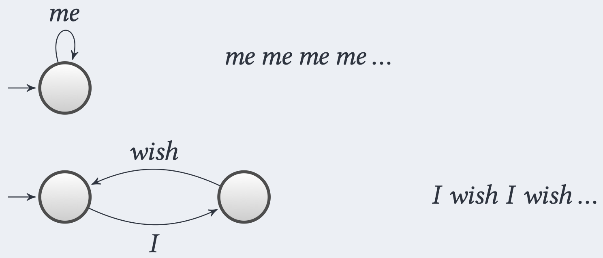
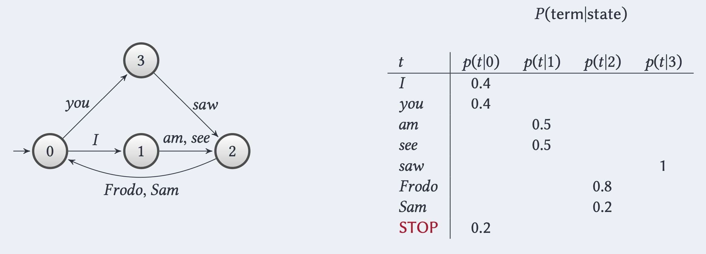
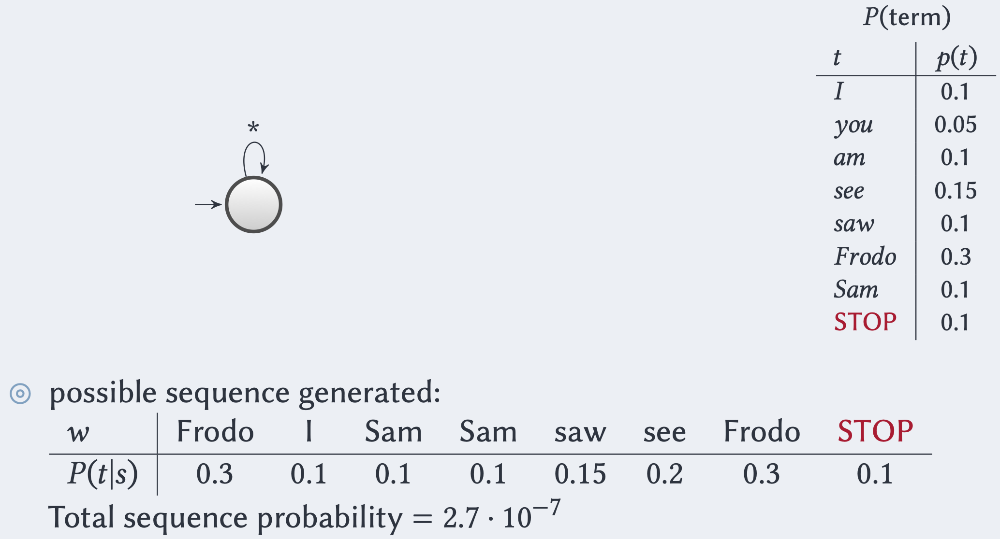

Nel [[Probabilistic Ranking Principle]] sfruttavamo la regola di [[Appendice Probabilità#Bayes' Rule|regola di Bayes]] per esprimere la probabilità che un documento sia rilevante rispetto a una query in funzione della rappresentazione del documento.

 $$P(R \vert d,q) = \frac{P(d \vert R, q) P(R \vert q)}{P(d \vert q)} = \frac{P(d \vert R, q) P(R \vert q)}{P(d)}$$
 dove
- $P(d \vert R, q)$ è la probabilità di campionare un documento $d$  dal sottoinsieme dei **soli documenti rilevanti** rispetto a $q$.
- $P(R \vert q)$ è la probabilità di campionare a caso un qualsiasi documento rilevante rispetto a $q$.
 - $P(d)$ è la probabilità che il documento $d$ sia campionato dalla collezione. Osservare che $P(d \vert q) = P(d)$ perché a priori un campionamento di un documento è indipendente dalla query $q$.

Allo stesso modo possiamo definire un **modello generativo** che esprime la stessa probabilità in funzione della query $q$.

$$P(R \vert d, q) = \frac{P(q \vert R,d) P(R \vert d)}{P(q \vert d)} = \frac{P(q \vert R,d) P(R \vert d)}{P(q)}$$
dove:
- $P(q \vert R,d)$ è la probabilità che dato un documento $d$ risaputo essere **rilevante** per l'information need, qual è la probabilità che $q$ sia la query fatta che ha **generato** $d$.
- $P(R \vert d)$ è la probabilità che il documento $d$ sia rilevante.
- $P(q)$ è la probabilità che venga fatta la query $q$.

Assumendo che $P(q)$ e $P(R \vert d)$ siano **uniformi**, siamo quindi interessati a stimare $$P(R \vert d, q) \propto P(q \vert R, d)$$ o più in generale $$P(q \vert d)$$
Quindi, i Language Models rispondono alla domanda: **quanto è possibile osservare la query $q$ a partire un documento $d$?**.

## Language Model

Assumiamo di voler **generare** termine per termine un documento $d$.
Un **Language Model** $M_d$ per un documento $d$ definisce le regole da applicare per **generare** step by step ogni termine del documento $d$.

Un documento $d$ sarà considerato più rilevante per una query se il suo modello linguistico "rende naturale" la generazione di quella query.

Possiamo pensare ad $M_d$ come una sorta di **automa a stati finiti**, dove le transizione da stato a stato sono date dai termini.



Osserviamo che se stiamo in uno stato in cui abbiamo appena letto un verbo, ci sono varie probabilità di leggere un `oggetto` anziché un `articolo` anziché un `aggettivo`, tutte dipendenti dal verbo (**stato**) appena letto.

Perciò è buono avere una **distribuzione** su ogni transizione che parte da un dato stato.

 ^85bf9e

Osserviamo che in questo caso $M_d$ è una **catena di Markov** in cui la probabilità di generare il documento $d$ è data dalla **Random Walk** (che parte dallo stato $0$) tale che il passo $i$-esimo della passeggiata aleatoria corrisponde al termine $i$-esimo di $d$.

> **Esempio**
> Consideriamo il [[#^85bf9e|precedente]] language model $M_d$ e cerchiamo di generare il documento $$d = \text{"I am Frodo you saw Sam.} \texttt{[STOP]} \text{"}$$
> Partendo dallo stato $X = 0$ avremo la seguente probabilità
> $$\begin{align*}
P(d \vert M_d) &=\\
&= P(\text{"I"}|X = 0) \cdot P(\text{"am"}|X = 1) \cdot \\
&P(\text{"Frodo"}|X = 2) \cdot P(\text{"you"}|X = 0) \cdot \\
&P(\text{"saw"}|X = 3) \cdot P(\text{"Sam"}|X = 2) \cdot P(\texttt{[STOP]}|X = 0)\\
&= 0.4 \cdot 0.5 \cdot 0.8 \cdot 0.4 \cdot 1 \cdot 0.2 \cdot 0.2\\
&= 0.00256
\end{align*}$$

Un modello parecchio più semplificato è quello in cui ho un **unico stato** e definisco quindi una distribuzione sull'occorrenza dei termini (in generale, indipendentemente da ciò che ho letto prima).

Ovvero ogni termine $t$ ha una probabilità associata di essere il prossimo termine osservato, e tale probabilità è **indipendente** da ciò che è stato letto in precedenza.



```ad-warning
Osservare che le probabilità di generare un documento nel modello semplificato diventano di ordini di grandezza più piccole.
```


Essendo una query un documento, possiamo sfruttare i *language model* per stimare la rilevanza dei documenti restituiti dal sistema di IR.
Data una query $q$ e i documenti $d_1, ..., d_n$, definiamo per ciascuno i relativi language model $M_{d_1}, ..., M_{d_n}$.
Il documento più rilevante sarà quel documento $d$ che massimizzerà la probabilità $$P(q \vert M_d) = P(\langle w_1, ..., w_{|q|} \rangle \vert M_d) = \prod_{i=1}^{|q|} P(w_i \vert M_d)$$
L'assunzione di **indipendenza** dei termini $w_1, ..., w_{|q|}$ della query $q$ è anche nota come **Naive Bayes Conditional Independence assumption**.

```ad-important
Osserviamo che la probabilità $P(q \vert M_d)$ è uno [[Stimatore di Massima Verosimiglianza]].
Infatti si calcola la probabilità che la query osservata sia $q$, fissati dei parametri (ovvero il language model $M_d$).
In alternativa possiamo pensare a $P(q \vert M_d)$ come una misura che indica quanto il modello $M_d$ descrive la query $q$.
```

### Esempio
Consideriamo due docuementi $d_1, d_2$ con relativi language model $M_{d_1}, M_{d_2}$.

| $t$      | $P(t \vert M_{d_1})$ | $P(t \vert M_{d_2})$ |
| -------- | -------------------- | -------------------- |
| \[STOP\] | 0.1                  | 0.2                  |
| you      | 0.2                  | 0.1                  |
| see      | 0.05                 | 0.15                 |
| Frodo    | 0.2                  | 0.15                 |
| I        | 0.15                 | 0.1                  |
| am       | 0.05                 | 0.05                 |
| saw      | 0.05                 | 0.2                  |
| Sam      | 0.2                  | 0.05                 |

Consideriamo la seugente query $$q = \text{"Frodo saw Sam \texttt{[STOP]}"}$$ e calcoliamo la probabilità che venga generato dai precedenti language model
$$\begin{align*}
P(q \vert M_{d_1}) &= 0.2 \cdot 0.05 \cdot 0.2 \cdot 0.1 = 2 \cdot 10^{-4}\\
P(q \vert M_{d_2}) &= 0.15 \cdot 0.2 \cdot 0.05 \cdot 0.2 = 3\cdot 10^{-4} 
\end{align*}$$

Dato che $P(q \vert M_{d_2}) > P(q \vert M_{d_1})$ allora $d_2$ è più rilevante rispetto al documenti $d_1$, perché è più probabile che $M_{d_2}$ abbia **generato** la query $q$.

-------
# Stimare $P(q \vert M_d)$

## Multinomial
In base a quanto visto [[#Language Model|prima]] vogliamo stimare la probabilità che, all'interno della query $q$, un termine $t$ sia il prossimo ad essere osservato, **indipendentemente** da quanto letto in precedenza.

Assumendo che tale probabilità segua una [[Distribuzioni#Bernoulli|Bernoulliana]] di parametro $p_t$, allora la probabilità che il termine $t$ appaia $k$ volte nella query $q$ seguirà una [[Distribuzioni#Binomiale|legge Binomiale]] $$P(\text{df}_{t,q} = k) \sim \text{Binom}(\vert q \vert, p_t) \implies \binom{\vert q \vert}{k}p_t^k (1-p_t)^{\vert q \vert - k}$$
Combinando le probabilità di osservare $k_1, ..., k_{m}$ occorrenze dei termini $t_1, ..., t_m$ nella query $q$ può essere quindi modellato come [[Distribuzioni#Multinomiale (multivariata)|Multinomiale]]
$$P(\text{df}_{t_i,q} = k_i \forall i = 1, ..., m) = \frac{\vert q \vert!}{k_1!\cdots k_m!} \prod_{i=1}^{m} p_{t_i}^{k_i}$$

Dato che nel language model $M_d$ le probabilità $p_t$ sono date da $P(t \vert M_d)$ allora avremo che $$P(\text{df}_{t_i,q} = k_i \forall i = 1, ..., m \vert M_d) = \frac{\vert q \vert!}{\prod_{t \in q}\text{tf}_{t,q}!} \prod_{t \in q} P(t \vert M_d)^{\text{tf}_{t,q}}$$
Dato che il fattore $$\frac{\vert q \vert!}{\prod_{t \in q}\text{tf}_{t,q}!}$$conta il numero di modi in cui i temini della query possono essere ordinati è una costante **indipendente** dal documento $d$ (dipende solo dalla query), possiamo interessarci solo della produttoria, quindi $$P(q|M_{d}) \approx \prod_{t \in q}P(t \vert M_d)^{\text{tf}_{t,q}}$$
Intuitivamente, un documento riceve score alto se assegna alta probabilità ai termini presenti nella query, e se questi termini compaiono molte volte nella query.

## Formalizzazione ML

Sia $d$ un documento e siano $t_{1}, t_{2}, \dots$  i termini all'interno del documento. Allora $$M_{d} = \{P(t_{i} | M_{d})\ \forall t_{i} \in d\}$$Quindi, poiche $M_{d}$ fornisce una distribuzione di probabilità, vale che:$$\sum_{i=1}^{|V|} P(t_{i}| M_{d}) = 1$$dove $V$ è il vocabolario. A questo punto, fisatto un $t \in d$, ci chiediamo di stimare $P(t | M_{d})$.
Dato che abbiamo detto che $P(t \vert M_d)$ è uno [[Stimatore di Massima Verosimiglianza]], sappiamo che il MLE di una **bernoulliana** equivale essattamente alla [[Random Sample#Media campionaria|media campionaria]].
Perciò $$P(t \vert M_d) = \frac{\text{tf}_{t,d}}{\vert d \vert}$$

In conclusione, data una query $q$ possiamo calcolare la **rilevanza** di un documento $d$ come $$P(d \vert q) \approx P(q \vert M_d) \approx \prod_{t \in q} \left( \frac{\text{tf}_{t,d}}{\vert d \vert} \right)^{\text{tf}_{t,q}}$$

----
## Avoid Zero Occurrences - Smoothing

La stima MLE ha un problema enorme: se un termine della query non compare nel documento, allora $tf_{t,d} = 0$ ,  e quindi $P(d|M_{d}) = 0$. Di conseguenza si annullerebbe completamente la probabilità di osservare la query a partire dal documento, anche se magari il documento è molto rilevante per la query. Questo problema è noto come **veto power**

Consideriamo un esempio.
- $d$ = *"From Sam Doom"*
- $q$ = *"Frodo goes to mount Doom"*

Avremo quindi che

| t     | $P(t \vert M_d)$ |
| ----- | ---------------- |
| Frodo | 0.33             |
| Sam   | 0.33             |
| Doom  | 0.33             |
| goes  | 0                |
| to    | 0                |
| mount | 0                |

Secondo questo lagnuage model avremo che $P(q \vert M_d) = 0$, nonostante il documento $d$ non sia del tutto irrilevante.

Abbiamo quindi bisogno di fare uno **smoothing** di $P(q \vert M_d)$, cercando di evitare le occorrenze nulle.

### Laplace Smoothing

Come prima soluzione nel calcolo della **term frequency** potremmo sommare una quantità costante non nulla, come per esempio 1.
$$\text{tf}_{t,d} + 1$$
Così facendo avremo però che $\sum_{t \in d} \text{tf}_{t,d}+1 > \vert d \vert$, e che quindi $P(t \vert M_d)$ non è più una distribuzione (in quanto non avremmo somma 1).

Dobbiamo quindi normalizzare opportunamente $$P(t \vert M_d) = \frac{\text{tf}_{t,d} + 1}{\vert d \vert + |V|}$$ dove $V$ è il vocabolario.

Consideriamo il seguente **esempio**: sia $|d| = 100$, $|V| = 10000$.
- *Senza smoothing:* Se `Frodo` compare 5 volte, $$P(\text{Frodo} | M_{d}) = \frac{5}{100} = 0.05$$
- *Laplace Smoothing:* $$P_{{lap}}(\text{Frodo} | M_{d}) = \frac{5 + 1}{100 + 10000} \approx 0.0006$$Ottenendo una probabilità molto più bassa, che non riflette adeguatamente la rilevanza del documento rispetto alla query. Questo succede perché aggiungendo 1 a tutti i 10k termini del vocabolario, è come se avessimo aggiunto 10k termini artificiali al documento.

Quindi Laplace Smoothing è solo didattico, ma non usato nella pratica.

### Jelinek-Mercer Smoothing

Possiamo poi considerare come fattore aggiuntivo la probabilità che un termine appaia rispetto all'**intera collezione**.
Ovvero se un termine $t$ non appare molte volte in un documento, ma è comunque un termine parecchio frequente, voglio che in qualche modo la probabilità che esso venga letto come prossima parola sia lontana dal valore zero.
Definiamo quindi un *language model* $M_c$ relativo all'intera collezione $c$.
$$P(t \vert M_c) = \frac{\text{cf}_t}{T}$$ dove:
- $\text{cf}_t$ è la **collection frequenty** del termine $t$, ovvero il numero di occorrenze all'interno dell'intera collezione $c$.
- $T = \sum_{t}\text{cf}_t$ è un fattore di **normalizzazione**.

Perciò possiamo stimare la probabilità che un termine $t$ appaia in un documento $d$ tramite una **combinazione lineare** dei due language model $M_d, M_c$
$$
\begin{align*}
P(t \vert d) &= \alpha P(t \vert M_d) + (1-\alpha)P(t \vert M_c)\\
&= \alpha\frac{tf_{t,d}}{|d|} + (1 - \alpha) \frac{cf_{t}}{T}
\end{align*}
$$
dove $\alpha \in \left[0,1\right]$ è un **iper-parametro** che bilancia il peso tra $M_d$ e $M_c$.

Jelinek-Mercer risolve chiaramente il problema degli zeri in quanto se un termine non compare nel documento resta comunque la probabilità data dalla collezione, che è sempre maggiore di 0.

- Se $\alpha \approx 1$, diamo più peso al documento,
- Se $\alpha \approx 0$, diamo più peso alla collezione.

In genere si tende ad usare $\alpha$ piuttosto alto per favorire l'usabilità dell'utente aspettandosi query brevi.

Jelinek-Mercer ha però il seguente difetto: **usa lo stesso $\alpha$ per tutti i documenti, indipendentemente dalla loro lunghezza**.

#### Esempio

Consideriamo una collezione con soli due documenti:
- $d_{1}$ : `Frodo and Sam reached mount Doom with the help of Gollum`
- $d_{2}$: `Gollum was attracted by the One Ring`
e consideriamo la query $q$: `Gollum Ring`. Usiamo Jelinek-Mercer con $\alpha = \frac{1}{2}$. Allora $$|d_{1}| = 11, \quad |d_{2}| = 7, \quad T = 18$$
- Per $d_{1}$ abbiamo che: 
$$
\begin{align*}
P(\text{Gollum} | d_{1}) = \frac{1}{2}\left( \frac{1}{11} + \frac{2}{18} \right) \\
P(\text{Ring} | d_{1}) = \frac{1}{2}\left( \frac{0}{11} + \frac{1}{18} \right)
\end{align*}
$$
- Per $d_{2}$
$$
\begin{align*}
P(\text{Gollum} | d_{2}) = \frac{1}{2}\left( \frac{1}{7} + \frac{2}{18} \right) \\
P(\text{Ring} | d_{2}) = \frac{1}{2}\left( \frac{1}{7} + \frac{1}{18} \right)
\end{align*}
$$
Quindi, 
$$
\begin{align*}
P(q | d_{1}) = P(\text{Gollum} | d_{1}) \cdot P(\text{Ring} | d_{1}) \approx 0.0028 \\
P(q | d_{2}) = P(\text{Gollum} | d_{2}) \cdot P(\text{Ring} | d_{2}) \approx 0.0126
\end{align*}
$$
In conclusione, otteniamo che $d_{2} > d_{1}$.

#### Esercizio Possibile All'Esame
Consideriamo una collezione con soli due documenti:
- $d_{1}$ : `Frodo had a small sword and a coat`
- $d_{2}$: `The Shire was a small region in the west of Middle Earth`
e consideriamo la query $q$: `west small`. Usiamo Jelinek-Mercer con $\alpha = \frac{1}{2}$. Allora $$|d_{1}| = 8, \quad |d_{2}| = 12, \quad T = 20$$
### Dirichlet Smoothing

Dirichlet aggiunge delle occorrenze fittizie di ogni termine del vocabolario al documento in proporzione della loro probabilità nella collezione, secondo un nuovo parametro $\mu$ che controlla quante di queste occorrenze aggiungere, che sarà dato da: $$\mu P(t | M_{c})$$
Ad esempio, sia $P(\text{Ring} | M_{c}) = 0.01$ e $\mu = 100$, allora il numero di occorrenze di `Ring` che aggiungiamo ad ogni documento sarà: $$100 \cdot 0.01 = 1$$ In questo modo, la parola `Ring` comparirà almeno una volta in ciascun documento, anche in documenti in cui non dovrebbe comparire.

Il conteggio **reale** di un termine $t$ in un documento $d$ rimane sempre $tf_{t,d}$, qundi il numero totale di occorreze di $t$ in $d$ sarà: $$tf_{t,d} + \mu P(t | M_{c})$$
Per ottenere una distribuzione di probalità, come al solito dobbiamo normalizzare dividendo per il totale, quindi $$P_{Dir}(t | M_{d}) = \frac{tf_{t,d} + \mu P(t | M_{c})}{|d| + \mu}$$
#### Proof Dirichlet

$$
\begin{align*}
P_{\text{Dir}}(t \mid M_{d})
    &= \frac{tf_{t,d} + \mu\, P(t \mid M_{c})}{|d| + \mu} \\
    &= \frac{|d|}{|d| + \mu} \cdot \frac{tf_{t,d}}{|d|}
       + \frac{\mu}{|d| + \mu} \cdot P(t \mid M_{c}) \\
    \left[ P(t \mid M_{d}) = \frac{tf_{t,d}}{|d|} \right] &= \frac{|d|}{|d| + \mu} \cdot P(t \mid M_{d})
       + \frac{\mu}{|d| + \mu} \cdot P(t \mid M_{c}) \\
    \left[ \alpha = \frac{|d|}{|d| + \mu} \right]&= \alpha\, P(t \mid M_{d}) + (1 - \alpha)\, P(t \mid M_{c})
       
\end{align*}
$$
Questa formula mostra quindi che Dirichlet è **un'interpolazione documento-collezione, proprio come Jelinek-Mercer**, con $$\left[ \alpha = \frac{|d|}{|d| + \mu} \right]$$**che dipende dalla lunghezza lunghezza del documento**. In particolare:
- Se $d \gg \mu$, allora $\alpha \approx 1$ e quindi per documenti molto lunghi si da più peso al documento rispetto alla collezione (comportamento simile ad un AND, se un termine della query non è presente nel documento molto lungo è molto grave).
- Se $d \ll \mu$, allora $\alpha \approx 0$, ossia per documenti molto corti si dà più peso alla collezione e meno al documento.

Fissato $|d|$, se $\mu$ cresce, allora $\alpha$ diminuisce e quindi si da più peso alla collezione, mentre se $\mu$ diminuisci, allora $\alpha$ aumenta e quindi si dà più peso al documento.

In conclusione, lo stimare MLE con Dirichlet è: $$P_{Dir}(q | M_{d}) = \prod_{i = 1}^{|q|}P_{Dir}(t_{i} | M_{d})$$ Dovendo moltiplicare **probabilità molto piccole**, si preferisce passare al logaritmo, quindi si ottiene $$\log P_{Dir}(q | M_{d}) = \sum_{i = 1}^{|q|} \log P_{Dir}(t_{i} | M_{d})$$

## Conclusioni

Jelinek-Mercer utilizza un $\alpha$ uguale per tutti i documenti, mentre Dirichlet fa si che il peso dato al documento rispetto alla collezione dipenda dalla lunghezza del documento stesso.

- **Dirichlet spesso funziona molto bene per query corte/keyword queries** in quanto danno molto peso al documento.
- **Jelinek-Mercer spesso funziona meglio per query lunghe e verbose** in quanto query lunghe hanno più probabilità di contenere termini mancanti, per cui uno smoothing più aggressivo è più efficace.

**VSM vs BM25 vs LM**

- **VSM**: basato sulla similarità geometrica, tipicamente cosine similarity, sfrutta rappresentazioni vettoriali dei documenti. L'idea alla base è che documenti e query sono rappresentati come vettori in uno iperspazio ad altissima dimensionalità.
- **BM25 e LM:** sono motivati probabilisticamente: il primo parte dal *Probabilistic Retrieval* framework, modellando la probabilità che un documento sia rilevante data un query, mentre il secondo modella la probabilità della query dato un documento.

Gli LM hanno il vantaggio di essere molti semplici: BM25 usa una formula molto complessa dopo un numero di assunzioni e semplificazioni, mentre VSM sono ragionamenti geometrici empirici.

Nella realtà si tende ad usare maggiormente BM25 perché ha maggior controllo sui parametri relativi alla normalizzazione della lunghezza del documento e alla saturazione del $tf$.

Infine, BM25 e VSM fanno alto utilizzo della document frequency, mentre gli LM usano molto anche la collection frequency.

 A questo punto ci rimane solo un'ultimo problema: per calcolare lo score dobbiamo considerare tutti i documenti che contengono almeno una parola della query (OR di moltissimi documenti), è necessario quindi studiare delle tecniche di ottimizzazione in questo senso.