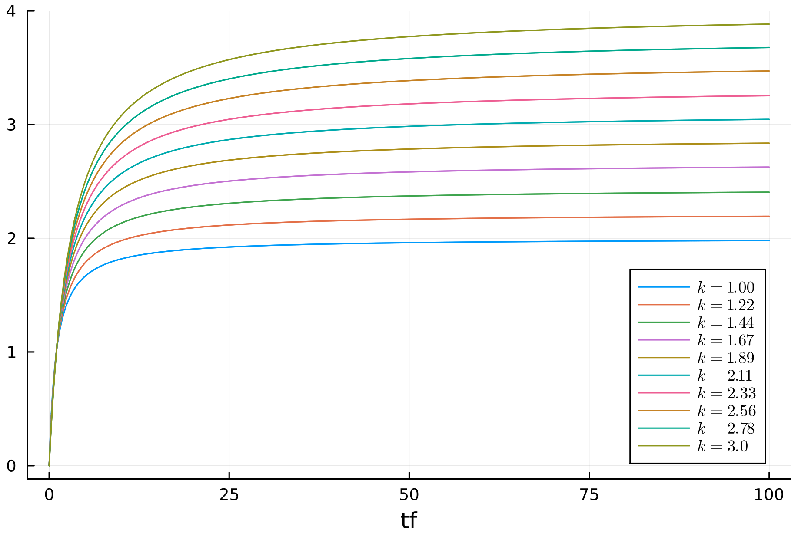
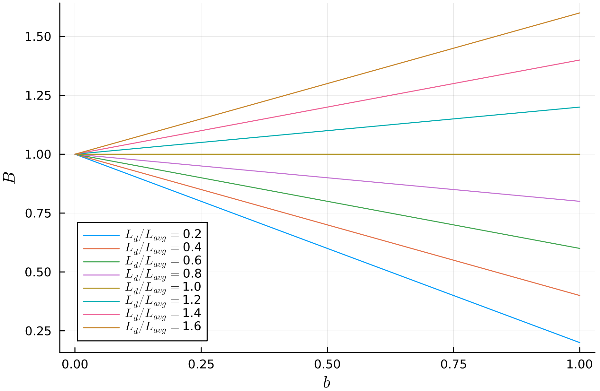

**Okapi BM25** è una funzione di ranking probabilistica basata sul modello **bag of words** che tiene conto della **term frequency** dei termini nei documenti, normalizzando opportunamente rispetto alla lunghezza del documento.

Prendiamo come punto di partenza la [[Term occurrences as 2-Poisson#^7a2ded|formula]] ricavata dalla [[Term occurrences as 2-Poisson]] $$RSV_d = \sum_{t \in q}\frac{(k_1 + 1)\text{tf}_{df}}{k_1 + \text{tf}_{df}}\log{\frac{N}{\text{df}_t}}$$
dove:
- $N$ è il numero di documenti nella collezione
- $\text{df}_t$ (**document frequency**) il numero di documenti nella collezione che contengono il termine $t$
- $\text{tf}_{df}$ (**term frequency**) il numero di volte in cui il termine $t$ appare nel documento $d$
- $k_1$ è un **parametro di tuning** che normalizza la grandezza della term frequency $\text{tf}_{df}$.
- Il fatore $k_1 + 1$ mantiene il ranking monotono (non modificando l'ordine), e fa si che il fattore di scaling rimane 1 nel caso in cui $\text{tf}_{df}=1$. Inoltre $k_1 + \text{tf}_{dt}$ serve per evitare di avere $\frac{0}{0}$ nel caso in cui $\text{tf}_{df} = 0$.

Questo scoring è simile al [[TF-IDF weight|tf-idf scoring]] con la differenza che i valori rimangono normalizzati.


Possiamo osservare che $k_1$ tiene limitato il contributo del $\text{tf}_{dt}$ al suo crescere.
Generalmente $k_1$ ha come valori tra $1.2$ e $2$.

Tale normalizzazione è necessaria perché in genere documenti molto grandi tendono ad avere un valori di $\text{tf}_{dt}$ molto grandi.

### Esercizio

Interpretiamo la formula per i vari valori di $k_1$. 
- Per $k_1 = 0$, sostituendo nella formula otteniamo $\frac{tf}{tf} = 1$, quindi in questo modo il numero di occorrenze non contribuisce allo score, basta che il termine appaia, e quindi di ritorna al **BIM**.
- Per $k_{1} = 1$, sostituendo nella formula otteniamo $\frac{(1+1)tf}{1+tf} \approx \frac{2tf}{1 + tf}$, quindi lo score cresce all'aumentare di $tf$ ma satura velocemente, al più si avvicina a 2.
- Per $k_1 \to \infty$ si ha $\frac{(k_{1}+1)tf}{k_{1} + tf} \approx tf$, quindi in questo caso NON satura, ma cresce linearmente all'aumentare di $tf$.

## Document length normalization

Come abbiamo visto in precedenza, nei documenti lunghi, la $tf$ tende ad essere molto alta, ma questo non significa necessariamente che quei documenti siano più rilevanti.

Ma non possiamo normalizzare direttamente rispetto alla grandezza del documento, dobbiamo prima fare delle considerazioni a riguardo.

- Se il documento è molto **verboso** allora il $\text{tf}_{dt}$ è elevato e quindi conviene normalizzare rispetto alla dimensione del documento.
- Se invece il documento è a **large scope** (parla di molti argomenti) anche se la sua dimensione è grande avremo che i $\text{tf}_{dt}$ non sono eccessivi. Quindi non conviene normalizzare rispetto alla grandezza del documento, rischiamo di perdere informazioni.

Dobbiamo quindi applicare una **normalizzazione parametrizzata**.
$$L_d = \sum_{t} \text{tf}_{d,t} \quad \text{lunghezza del documento } d$$
$$L_{\text{avg}} = \frac{\sum_{d \in D} L_d}{\vert D \vert} \quad \text{lunghezza media dei documenti nella collezione}$$
Una possibile normalizzazione parametrizzata è $$B = (1-b) + b\frac{L_d}{L_{\text{avg}}}\;\;\; 0 \leq b \leq 1$$
Con $b \to 1$ abbiamo una normalizzazione maggiormente pesata verso la lunghezza del documento. Andiamo quindi a penalizzare maggiormente i documenti più lunghi.
Con $b \to 0$ si tende a perdere il peso rispetto alla lunghezza del documento, lasciando solo la $\text{tf}_{d,f}$.

$$
\begin{align*}
RSV_d &= \sum_{t \in q}\frac{(k_1 + 1)\text{tf}_{df}}{k_1 \cdot B + \text{tf}_{df}}\log{\frac{N}{\text{df}_t}} \\ 
&= \sum_{t \in q}\frac{(k_1 + 1)\text{tf}_{df}}{k_1 \cdot \left[ (1-b) + b\frac{L_{d}}{L_{avg}} \right] + \text{tf}_{df}}\log{\frac{N}{\text{df}_t}}
\end{align*}
$$

Il valore $B$ è messo al denominatore perché a valori alti di $B$ corrispondono minori di $RSV_d$.



- Caso $L_d / L_{\text{avg}} > 1$: la lunghezza del documento è maggiore della media.
	- al **crescere** di $b$ abbiamo che $B$ **decresce** (abbiamo meno contributo rispetto alla lunghezza del documento).
- Caso $L_d / L_{\text{avg}} < 1$: la lunghezza del documento è minore della media.
	- al **crescere** di $b$ abbiamo che $B$ **cresce** (abbiamo maggiore contributo rispetto alla lunghezza del documento).

Mediamente $b$ ha valori $0.75$.

### Esercizio

Interpretiamo la formula BM25 per vari valori di k.
- $k = 0$ si ha $\frac{tf}{tf} = 1$ e quindi si ritorna al **BIM**.
- $b = 0$ si ha $B = (1 - 0) + 0 \frac{L_{d}}{L_{avg}} = 1$, quindi non c'è normalizzazione e si torna al caso $\frac{(k+1)tf}{k + tf}$
- $k = 1 \land b = 0$, si torna al caso $\frac{2tf}{1 + tf}$, quindi si ha un $tf$ che conta ma che satura velocemente.
- $k \to \infty \land b = 0$, si torna al caso $\frac{(k+1)tf}{k + tf} \approx tf$, quindi si ha un $tf$ che cresce linearmene e che non satura.
- $k \to \infty \land b = 1$, si ha normalizzazione piena per la lunghezza e $$\frac{(k+1)tf}{k \frac{L_{d}}{L_{avg}} + tf} \approx tf \frac{L_{avg}}{L_{d}}$$quindi si ha un $tf$ che non satura ma cresce linearmente.
## Weighting for long queries

Per query molto grandi possiamo applicare la stessa normalizzazione applicata rispetto alla term frequency.
L'idea è che se un termine appare molte volte in una query è perché magari è maggiormente importante.

$$RSV_d = \sum_{t \in q} \frac{(k_2+1)\text{tf}_{q,t}}{k_2+\text{tf}_{q,t}} \cdot \frac{(k_1 + 1)\text{tf}_{df}}{k_1 \cdot B + \text{tf}_{df}} \cdot \log{\frac{N}{\text{df}_t}}$$
Dove $k_2$ è un altro parametro di tuning, generalmente tra $1.2$ e $2$.

```ad-note
Non ha senso normalizzare rispetto alla **lunghezza** della query, in quanto non vogliamo penalizzare le term frequency dei termini della query.
Inoltre le query non sono mai esageratamente grandi.
```

### Possibile Domanda Esame

Dati 1000 documenti, data la formula BM25, come costruisco il motore di retrieval?

1. Per prima cosa devo costruire l'inverted index. Quindi preprocessing della collezione, per ogni documento tokenizzazione ed eventuale rimozione delle stopwords e stemming.
2. Uso algoritmi come BSBI o SPMI per la creazione dell'inverted index.
3. Per calcolare BM25, è necessario avere a disposizione statistiche, in particolare $N$, $df_{t}\ \forall\ t \in C$, $L_{d}$ e $L_{avg}$. 
4. Quando arriva una query $q$ si procede come segue: Si **recuperano tutti i candidati facendo OR delle posting list dei termini della query**. Per ogni candidato $d$ si calcola BM25 ($RSV_{d}$). Infine. ottenuti tutti i $RSV_{d}$, si ordinano in modo decrescente e si restituiscono i top $k$ risultati.

