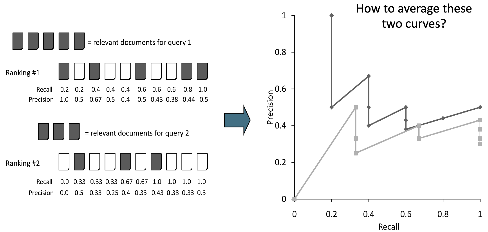
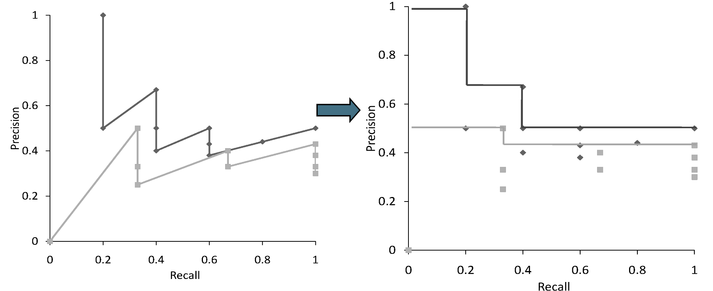
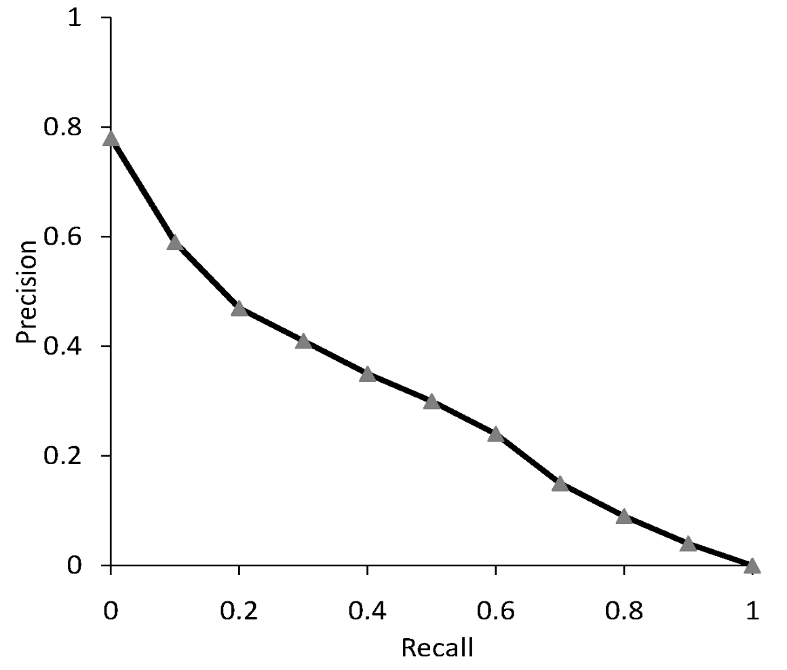
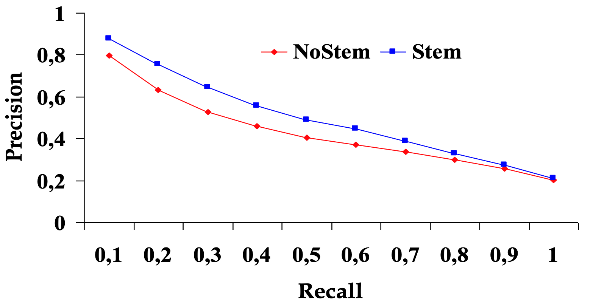
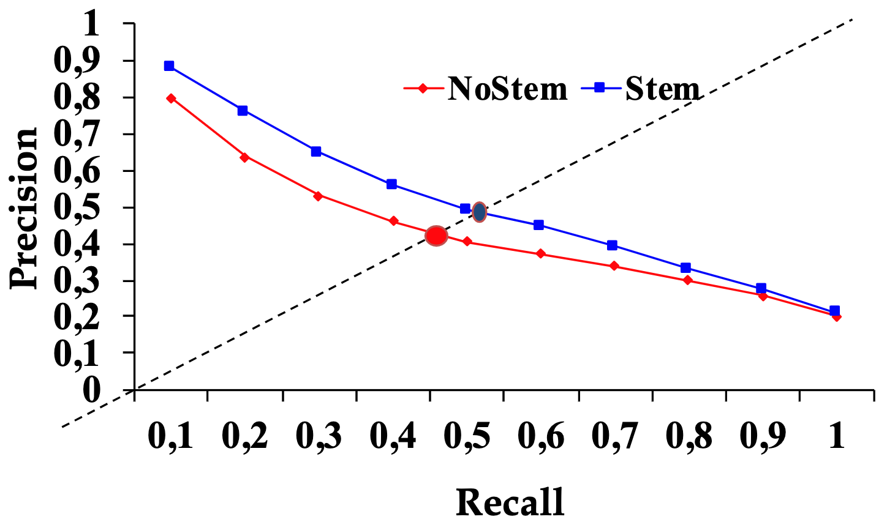
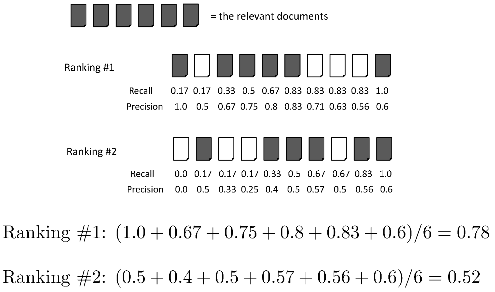
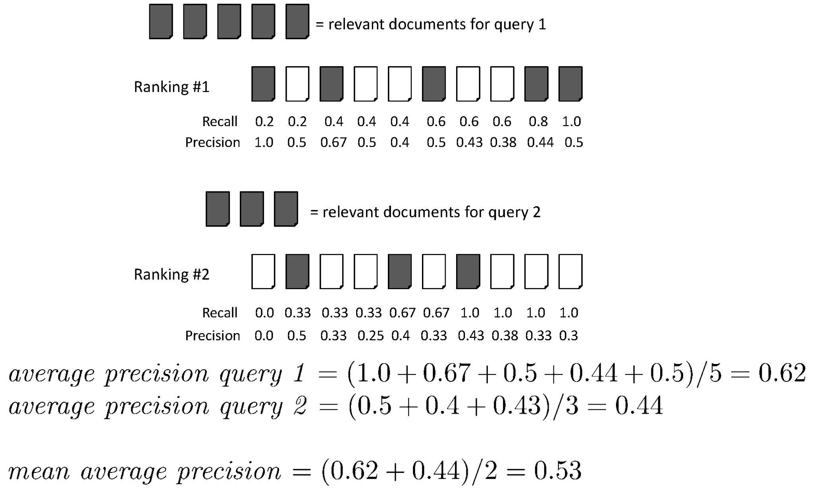

Misure come [[Set Based Measures|precision, recall ed F-measure]] sono basati solamente sugli **insiemi** dei documenti restituiti e sull'insieme dei documenti target.

Abbiamo visto che un sistema di IR non si limita solo a restituire un sottoinsieme di documenti, bensì ne definisce un [[Scoring, term weighting & the vector space model|ranking]] di significatibilità (rispetto alla query).
Abbiamo perciò bisogno di estendere questi concetti di *misura della qualità* anche agli **score** delle pagine restituite.

Esistono in generale due modi per rappresentare la rilevanza di un documento:
- **Relevance binaria**: per ogni documento restituito, si indica se è rilevante o meno (1 o 0).
- **Relevance graduta**: per ogni documento restituito, si indica un punteggio di rilevanza (ad esempio da 0 a 3)

----------
# Precision@K (P@K)
Per estendere il concetto di [[Set Based Measures#Precision and Recall|precision]] sui [[Scoring, term weighting & the vector space model|ranking]] procediamo nel seguente modo:
1. Prendiamo il risultato della nostra query.
2. Lo ordiniamo in base agli [[Scoring, term weighting & the vector space model|score]] delle pagine.
3. Prendiamo i primi $K$ documenti.
4. Definiamo la **precision** sull'insieme composto da quei soli $k$ documenti.
Intuitivamente stiamo **restringendo** il calcolo della precision sui primi $K$ documenti in cima al **ranking**.
Questa quantità è detta **precision@K** o **p@K**.

$$P@K = \frac{TP@k}{TP@K + FP@K} = \frac{\text{\# rilevanti nei primi K}}{K}$$

Intuitivamente, la Precision@K risponde alla domanda: **Tra i primi k documenti restituiti, quanti sono rilevanti?**.

In maniera analoga, possiamo definire anche la **recall@K** o **r@K**.

$$R@K = \frac{TP@k}{TP@K + FN@K} = \frac{\text{\# rilevanti nei primi K}}{\text{\# rilevanti}}$$
Ha senso usare questa metrica per guardare solo i primi $K$ risultati restituiti dal sistema di IR proprio perché è lì che gli utenti tendono a cliccare. Se ad esempio un sistema di IR restituisci 100 documenti, ma gli utenti cliccano solo sui primi 10, allora è importante avere precision e recall alta nei primi 10 documenti restituiti, piuttosto che nei successi 90.

> **Esempio**
> Consideriamo il seguente insieme di documenti $\langle$ ✅ ❌ ✅ ❌ ✅ $\rangle$ come risultato di un retrieval, dove con ✅ indichiamo i **true positive** e con ❌ i **false positive**.
> Avremo le seguente **precision@K** per i diveri valori di $K$:
> - $P@3 = 2/3$
> - $P@4 = 1/2$  
> - $P@5 = 3/5$

## Recall-Precision Graph
Dati tutti i valori di **precision@K** e **recall@K** (per $K$ da 1 alla dimensione del retrieval) possiamo metterli in un grafico **precision/recall**.



Il grafo è calcolato come segue:
1. Data una query, si scorre il ranking dei documenti restituti. Per ogni documento restituito, si calcolano precision e recall considerando solo i documenti fino a quel punto (P@K e R@K).
2. In quanto la curva di precision-recall non è monotona, conviene **interpolare** i valori del grafico con la seguente funzione:$$P(r) = \max{\lbrace P': \exists (R', P') \in S \left[ R' \geq r \right] \rbrace}$$dove $S$ è l'insieme di **punti osservati** $(P,R)$. Quindi la precision interpolata a un certo livello di recall $r$ è data dalla massima precision osservata in qualsiasi punto con recall maggiore o uguale a $r$.
	Perché la curva non è monotona? Se troviamo un documento non rilevante, la precision si abbassa, ma se troviamo poi dei documenti rilevanti essa risale. La recall invece è sempre crescente, in quanto il numero totale di documenti rilevanti è fisso (denominatore) mentre nella precision dipende da FP che varia.
3. Una volta ottenuta la curva interpolata, si può fare la media tra tutte le curve per ottenere una curva che rappresenta la performance del sistema di IR su tutte le query.




Otterremo quindi una descrizione del nostro motore di IR tramite una **curva** (detta **curva precision/recall**) che rappresenta come **precision** e **recall** sono tra loro **bilanciate** nel nostro motore di IR. ^656137

```ad-info
Ricoridamo che **precision** e **recall** sono mutuamente bilanciate.
Generalmente al crescere di una, l'altra diminuisce.
```


 ^1af0ab

## Comparison among different IR Systems

Grazie alla [[#^1af0ab|curva precision/recall]] possiamo mettere a confronto due differenti sistemi di IR (ovviamente testandoli sullo stesso insieme di documenti target e sulle stesse query).

**Il sistema di IR migliore è quello che ha la curva più alta** (precision più alta a parità di recall).

Per esempio possiamo mettere a confronto due sistemi di IR dove in uno viene usato lo [[Inverted Index#Stemming and Lemmatization|stemming]] mentre nell'altro no.



Come metodo di paragone potremmo usare il **breakeven point** delle due curve. Questo punto rappresenta un compromesso di massimo equilibrio tra le due.
Tale punto è il punto in cui la curva si interseca con la retta $\text{recall} = \text{precision}$.



------
# Mean Average Precision (MAP)

L'idea dietro MAP è che non conta più solo sapere quanti documenti rilevanti sono stati restituiti, ma anche **in che posizione** sono stati restituiti nel ranking. Si premiano i sistemi che mettono i documenti rilevanti più in alto nel ranking, in quanto è più probabile che gli utenti clicchino sui primi risultati restituiti.

Siano $D_1, ..., D_r$ i documenti rilevanti restituiti dopo una query.
Consideriamo ora le loro rispettive **posizioni** $K_1, ..., K_r$ nel **ranking**, e calcoliamo i valori $P@K_1, P@K_2, ..., P@K_r$.

Per calcolare la **precision media** di una query possiamo fare la **media** dei valori $P@K_1, P@K_2, ..., P@K_r$.
$$\text{AvgPrecision} = (P@K_1 + P@K_2 + ... + P@K_r)\cdot \frac{1}{r}$$


Chiaramente se i documenti rilevanti sono tutti in alto nel ranking, allora si ottiene un $AP$ più alto, mentre se i documenti più rilevanti si trovano in basso, allora si ottiene un $AP$ più basso.

Una unità di misura molto usata è la **MAP** (**Mean Avarage Precision**), dove si fa una **media** sulle differenti **avarage precision**delle $Q$ query fatte per testare un sistema di IR.

$$\text{MeanAvgPrecision} = \frac{1}{Q}\sum_{q = 1}^{Q} AP_q$$
MAP rappresenta quindi la performance media del sistema di IR su tutte le query testate, tenendo conto sia della rilevanza dei documenti restituiti che della loro posizione nel ranking.



Alcune proprietà:

- MAP $\in \{0,1\}$, dove 1 indica che tutti i documenti rilevanti sono stati restituiti e posizionati in cima al ranking per ogni query, mentre 0 indica che per ogni query nessun documento rilevante sia stato restituito.
- MAP è una **macro averaging**, ogn query ha lo stesso preso rispetto alle altre.

Il principale **limite** di MAP è che assume che l'utente voglia trovare molti documenti rilevanti per la sua query, quando in realtà gli utenti sono interessati solo al primo risultato.