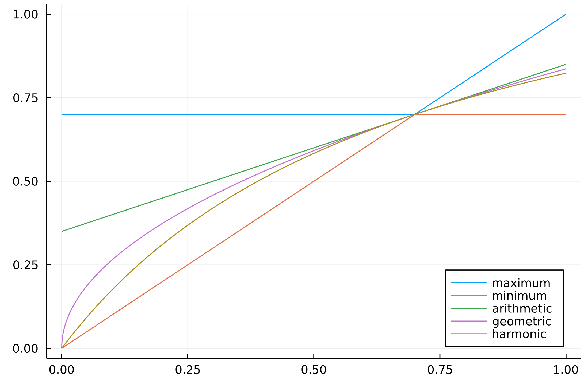

## Precision and Recall

Definiamo l'insieme $T$ di documenti **rilevanti**, detto anche **target**.
Sia invece $R$ l'insieme di documenti restituiti a seguito di una query.
Definiamo le seguenti misure

- **Recall**: Tra tutti i documenti rilevanti, quanti sono stati recuperati dal sistema di IR?
$$\text{recall} = \frac{\vert T \cap R \vert}{T} = \frac{tp}{tp + fn}$$ ^eed895
- **Precision**: Tra tutti i documenti recuperati, quanti sono rilevanti?
$$\text{precision} = \frac{\vert T \cap R \vert}{R} = \frac{tp}{tp + fp}$$ ^e84cfa

\ | **Relevant** | **Non Relevant**
---|---|---
**Retrieved** | true-positive: $tp = T \cap R$ | false-positive: $fp = R \setminus T$
**Not Retrieved** | false-negative: $fn = T \setminus R$ | true-negative: $tn = \lnot (T \cap R)$

**Nota**: Per ricordare facilmente le formule di precision e recall:
- Né precision né recall guardano i TN (documenti non restituiti non rilevanti, che sono tanti)
- Precision guarda solo i *positivi* ($p$ alla fine)

Analiziamo la relazione tra **precision** e **recall**.
Se la query ritorna pochi risultati, potrei avere molti documenti rilevanti ovvero **alta precision**, però recall bassa perché ne ritorno troppo pochi.
Ma mano che aumento il numero di documenti ritornati, aumento quelli rilevanti che riesco a recuperare ovvero aumento la **recall**, però tendo anche a includere sempre più documenti non rilevanti diminuendo la precision.
L'ideale è avere precision e recall abbastanza alti e simili (trovare il giusto **trade-off**)

### Esempio
Consideriamo l'insieme $T = \lbrace T_1, ..., T_6 \rbrace$ l'insieme dei documenti **target**, ed indichiamo con $X$ un qualsiasi documento **fuori** $T$.

\ | $T_2$ | $X$ | $T_3$ | $T_1$ | $T_6$ | $T_5$ | $X$ | $X$ | $X$ | $T_4$
---|---|---|---|---|---|---|---|---|---|---
**Recall** | 0.16 | 0.16 | 0.33 | 0.5 | 0.66 | 0.83 | 0.83 | 0.83 | 0.83 | 1.0
**Precision** | 1.0 | 0.5 | 0.66 | 0.75 | 0.8 | 0.83 | 0.71 | 0.62 | 0.55 | 0.6

\ | $X$ | $T_3$ | $X$ | $X$ | $T_6$ | $T_1$ | $T_4$ | $X$ | $T_5$ | $T_2$
---|---|---|---|---|---|---|---|---|---|---
**Recall** | 0.0 | 0.16 | 0.16 | 0.16 | 0.33 | 0.5 | 0.66 | 0.66 | 0.83 | 1.0
**Precision** | 0.0 | 0.5 | 0.33 | 0.25 | 0.4 | 0.5 | 0.57 | 0.5 | 0.55 | 0.6

Come si può osservare dall'esempio 1, se restituisco solo $T_2$ allora ho precisione massima, perche restituisco un'unico documento il quale è anche rilevante, mentre la recall è minima perché non è l'unico documento rilevante. Man mano che restituisco più documenti, la recall aumenta e la precision si abbassa.

------------
## Accuracy and Error
Altre due misure sono l'**accuracy** e l'**error**.
- **Accuracy**: la frazione di pagine correttamente classificate come rilevanti e non rilevanti $$\text{acc} = \frac{tp + tn}{tp+tn+fp+fn}$$ In contesti come IR, l'accuracy è una metrica che non si usa, in quanto la collezione  è enorme e quindi i documenti non rilevanti non restituiti (TN) sono tantissimi e domina il calcola, portando ad avere sempre accuracy bassa.
 ^0fb052
- **Error**: la frazione di pagine classificate in maniera sbagliata $$\text{err} = \frac{fp + fn}{tp+tn+fp+fn} = 1 - \text{acc}$$

----------
## F-Measure
In genere è preferibile usare una sorta di **media** tra **precisione** e **recall**.

Ricapitolando il trade-off:
- **Precision Alta, Recall Bassa**: Restituisco pochi documenti ma quasi tutti rilevanti, perdendo cosi dei possibili documenti utili.
- **Precision Bassa, Recall Alta**: Restituisco molti documenti ma molti non rilevanti, necessita di tanto tempo per leggere tutti i documenti.

![[IR_f_measure.png]]

L'ideale sarebbe avere sia Precision che Recall ad 1, ma è praticamente impossibile e quindi nella pratica si cerca di trovare un compromesso tra i due. Per questo motivo, spesso si usa una metrica che combina precision e recall, come ad esempio l'**F1-Score**

Sia $P$ la precisione e $R$ la recall, la **F-measure** usa una **media armonica** tra i duce valori $$F = \frac{1}{\alpha\frac{1}{P} + (1 - \alpha)\frac{1}{R}} = \frac{(\beta^2 + 1)PR}{\beta^2P + R}$$ dove $$\beta^2 = \frac{1-\alpha}{\alpha}$$
Per esempio, per $\alpha = 1/2$ avremo $\beta^2 = 1$ e quindi
$$F = \frac{1}{\frac{1}{2}(\frac{1}{P} + \frac{1}{R})} = \frac{2RP}{P + R}$$
Quando $\alpha = 1/2$ è nota come **F1-measure**.

L'utilizzo della media armonica è giustificato dal fatto che l'armonica penalizza maggiormente valori sbilanciati: se si ha altissima precision ma bassa recall (o viceversa), si vuole comunque avere F1-Score basso (mentre se avessi usato la media aritmetica avrei avuto un valore più alto).

Altri tipi di media tra precision e recall comuni sono:

**Type** | **Value**
---|---
maximum | $\max{\lbrace P, R \rbrace}$
minimum | $\min{\lbrace P, R \rbrace}$
arithmetic | $(P+R)/2$
geometric | $\sqrt{PR}$

