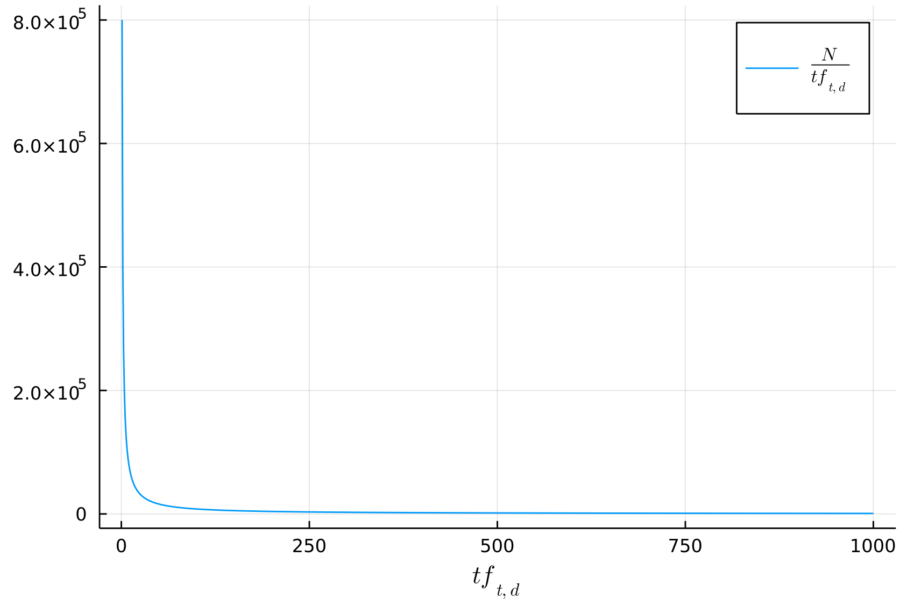
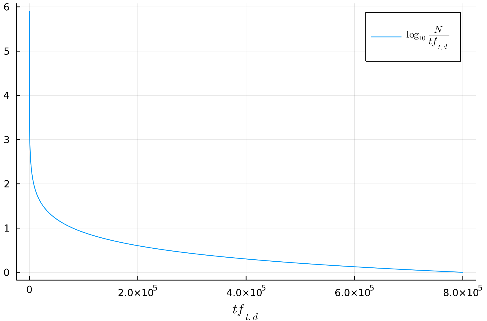

Consideriamo la query `the dog`.
Come risultato della query otterrò tantissimi documenti inutili alla mia ricerca, per il semplice motivo che è presente il termine `the` un numero elevato di volte.

Un primo approccio semplice che abbiamo già incontrato è la [[Inverted Index#Dropping common terms: stop words|rimozione delle stopwords]].
Questo metodo però non è molto elegante, perché alcune stopwords potrebbero risultare utili ai fini della mia query.
Per esempio, potrei cercare nella mia query `come si dice in inglese l'articolo "un"?`.
Eliminando le stopwords, gli unici termini utili risulterebbero `come, dice, inglese, articolo`.

Un'idea più elegante è invece che i termini che sono più **rari** in una lingua sono più **informativi** in un documento.
Più semplicemente si può pensare che un termine che occorre più volte sarà **meno informativo** di un termine **più raro**.

Se per esempio la mia query è `the Phenethylamine`, sicuramente il termine `Phenethylamine` è decisamente più utile ai fini della ricerca, anziché `the`.
E questo accade perché `Phenethylamine` è decisamente più raro nella lingua inglese rispetto a `the`.

È ragionevole quindi **pesare** i termini in base alla loro **rarità**, sfruttiamo di nuovo la loro **document frequency**.

Definiamo quindi la **informativeness** di un termine come
$$\text{idf}_t = \log_{10}{\frac{N}{\text{df}_t}}$$
dove $\text{df}_t$ è la **document frequency** del termine $t$ nella mia collezione, ed $N$ è il numero di documenti. ^3ca620

In altre parole, df$_t$ è il numero di documenti in cui appare il termine $t$.
Quindi, 
- se $t$ appare in pochi documenti, idf$_t$ è grande ($t$ è molto informativo) 
- se $t$ appare in molti documenti, idf$_t$ è piccolo ($t$ è poco informativo)
- se $t$ appare in tutti i documenti ($N$ = df$_t$), allora $\log(1) = 0$, e di conseguenza il termine non contribuisce affatto alla rilevanza di un documenti rispetto alla query, come ci aspettiamo.

Si preferisce applicare una trasformazione non lineare a $N/\text{df}_t$ per avere una curva di decrescita **meno ripida**.

A questo punto definiamo il **peso** di un termine $t$ rispetto a un documento $d$ combinando la sua [[Bag of words model - Term Frequency tf|term frequency]] e la sua [[#^3ca620|informativeness]]
$$w_{t,d} = (1 + \log{(\text{tf}_{t,d}})) \cdot \log{ \left( \frac{N}{\text{df}_t} \right)} = \text{tf-weight} \times \text{idf-weight}$$

Tale valore $w_{t,d}$ è anche noto come **tf-idf weight**.
- tf = *term frequency*
- idf = *informative document frequency*

Questo peso aumenta all'aumentare della frequenza del termine nel documento e all'aumentare della rarità del termine nella collezione.