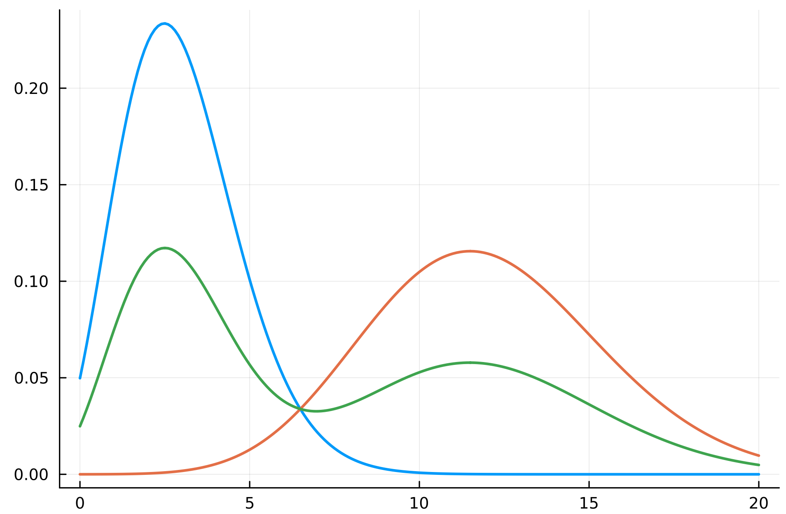
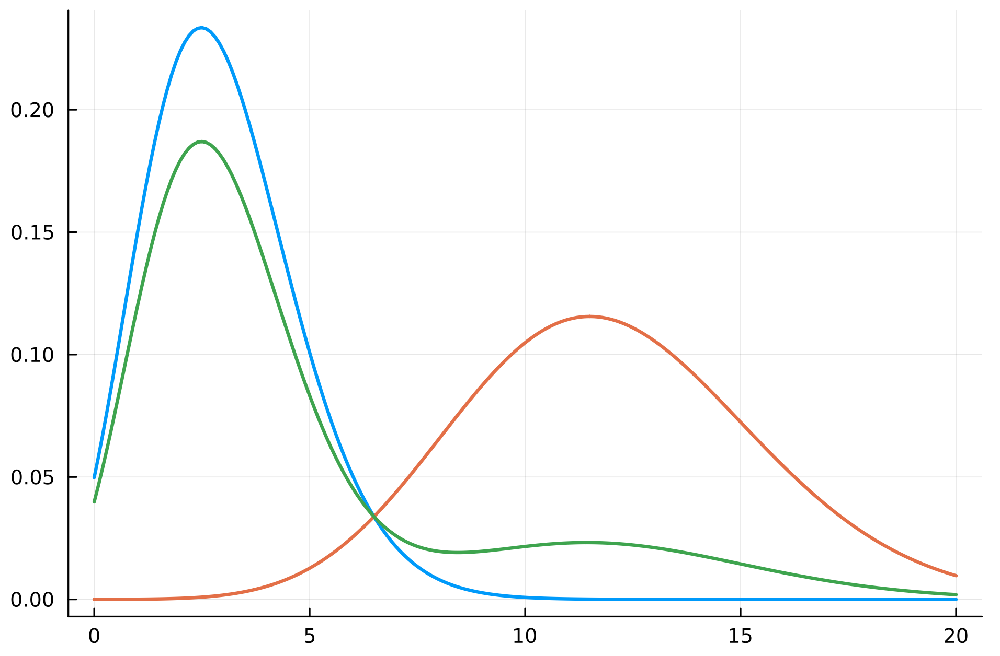

Dobbiamo mantere le seguenti 3 proprietà fondamentali:
1. **La term frequency di un termine presente nella query e nel documento deve aumentare lo score del documento**$$n_{j} \uparrow \implies RSV_{d} \uparrow$$
2. **I termini rari devono pesare di più**
3. **Saturazione**: l'effetto della $tf$ non deve essere lineare e unbounded. Da 1 a 2 occorenze il punteggio deve aumentare di molto, da 10 a 11 occorrenze non deve aumentare quasi per niente.

Classifichiamo i termini in due differenti classi:
- I termini di **elite**, i quali caratterizzano l'argomento di un documento.
- I termini **non d'elite**, i quali non descrivono l'argomento di un documento.

Un esempio di termini d'elite in genere li possiamo trovare nei **titoli** di un documento, oppure nell'**abstract** di articoli.

Possiamo descrivere ciascuno dei termini delle due classi mediante la **composizione** di due [[Distribuzioni#Poisson|Poisson]]: una per la prima classe e una per la seconda.

- $\text{Poisson}(\mu_{j})$ per il termine $j$ elite;
- $\text{Poisson}(\bar{\mu_{j}})$ per il termine $j$ non elite.

Sia $E_t$ una v.a. **binaria** che rappresenta l'*eliteness* del documento $t$ rispetto al documento in questione.
$$E_t = \begin{cases}
1 &\text{se }t\text{ è di elite rispetto a }d\\
0 &\text{altrimenti}
\end{cases}$$

Possiamo modellare $P(d_t = n_t \vert R,q)$ come segue
$$\begin{align*}
P(d_t = n_t \vert R,q)
&= P(d_t = n_t \vert E_t)P(E_t \vert R,q) + P(d_t = n_t \vert \overline{E}_t)P(\overline{E}_t \vert R,q)\\
\\
&= \text{Poisson}(n_t\vert\lambda=\mu_t)p_t + \text{Poisson}(n_t\vert\lambda=\overline{\mu}_t)(1-p_t)\\
\\
&= \frac{e^{-\mu_t}\mu_t^{n_t}}{n_t!}\cdot p_t + \frac{e^{-\overline{\mu}_t}\overline{\mu}_t^{n_t}}{n_t!}\cdot (1 - p_t)
\end{align*}$$

$$\implies P(d_t = 0 \vert R,q) = e^{-\mu_t}p_t + e^{-\overline{\mu}_t}(1-p_t)$$

dove
- $P(d_t = n_t \vert R,q)$ è la probabilità che un termine $t$ appaia $n_t$ volte all'interno di un documento rilevante.
- $P(E_t \vert R,q) = P(E_t = 1 \vert R,q) = p_t$ è la probabilità che il termine $t$ sia un termine d'elite per un documento rilevante.
- $P(\overline{E}_t \vert R,q) = P(E_t = 0 \vert R,q) = p_t$ è la probabilità che il termine $t$ sia un termine **non** d'elite per un documento rilevante.
- $\mu_t$ è il numero medio di termini d'elite in documenti rilevanti.
- $\overline{\mu}_t$ è il numero medio di termini **non** d'elite in documenti rilevanti.

Ossia la probabilità che il termine $t$ appaia $n_t$ volte in un documento rilevante è data dalla probabilità che ciò avvenga nel caso in cui il termine è sia elite o nel caso in cui non lo sia.

Analizziamo le seguenti grafici: Fissiamo un termine $t$; sull'asse $x$ abbiamo il numero delle occorrenze del termine, mentre sull'asse $y$ la probabilità che occorra. La cruva *blu* mostra la distribuzione di Poisson per i documenti per cui il termine non è elite. Osserviamo come la probabilità che il termine appaia poche volte è molto più alta rispetto alla probabilitò che appaia tante volte. Contrario invece l'andamento della curva *arancione* per i documenti in cui il termine è elite. La curva *verde* è la combinazione delle due curve, che tiene conto sia di quando è elite che di quando non lo è.

Possiamo quindi stimare il [[Introducing term frequency in BIM#^2d7816|Retrieval Status Value]] utilizzando queste nuove approssimazioni.

Siano:
- $C(n_{t}) = \text{Poi}(n_{t}; \mu_{t})$: la probabilità che il termine $t$ appaia $n_t$ volte in un documento rilevante se il termine è elite per il documento.
- $\bar{C}(n_{t}) = \text{Poi}(n_{t}; \bar{\mu_{t}})$: la probabilità che il termine $t$ appaia $n_t$ volte in un documento rilevante se il termine *non* è elite per il documento.
- $p_t = P(E_{t} | R, q)$: probabilità che il termine $t$ sia elite in un documento rilevante.
- $\bar{p_t} = P(E_{t})$: probabilità che il termine $t$ sia elite in un documento nell'intera collezione.
$$\begin{align*}
RSV_d &= \sum_{t \in q}\log{\frac{P(d_t = n_t \vert R,q) P(d_t = 0)}{P(d_t = n_t)P(d_t = 0 \vert R, q)}}\\
\\
&= \sum_{t \in q}
\log{\frac{
\left(C(n_{t})p_{t} + \bar{C}(n_{t})(1 - p_{t})\right) \cdot \left(C(0)\bar{p}_{t} + \bar{C}(0)(1 - \bar{p}_{t})\right)
}{
\left(C(0)p_{t} + \bar{C}(0)(1 - p_{t})\right) \cdot \left(C(n_{t})\bar{p}_{t} + \bar{C}(n_{t})(1 - \bar{p}_{t})\right)
}}
\end{align*}$$

Purtroppo tale valore è complesso e dispendioso da calcolare.
Possiamo quindi provare ad **approssimarlo** mediante una funzione più semplice avente le seguenti proprietà:
1. per $n_t = 0$ il contributo del termine $t$ alla rilevanza del documento deve essere $0$.
2. il contributo del termine $t$ alla rilevanza di un documento deve crescere in maniera **monotona** rispetto a $n_t$. ^c7675c
3. per $n_t \to \infty$ tale funzione deve tendere asintoticamente a $$\log{\frac{\text{Odds}(E_t \vert R,q)}{\text{Odds}(E_t)}} = \log{\frac{P(E_t \vert R,q)(1-P(E_t))}{(1-P(E_t \vert R,q))P(E_t)}}$$ ossia, non deve crescrere all'infinito bensì deve **saturare**. Intuitivamente, deve saturare perché TF è un'evidenza di eliteness di un termine per un documento. Se $n_t = 0$ allora non c'è nessun evidenza, se $n_t \neq 0$ allora deve dare maggiore evidenza, ma se $n_{t} \gg 0$ allora è chiaro che è un termine d'elite da ben prima.  
 ^66b474

## Saturazione

Abbiamo detto che per $n_{t} \to \infty$, il contributo deve **saturare**. Sia $$f(n_{t}) = \frac{(k+1)n_{t}}{k + n_{t}}$$Osserviamo che questa funzione è perfetta. Fintanto che $n_{t}$ è piccolo allora la funzione cresce quasi linearmente, ma per $n_{t}$ molto grande tende a $\infty$ la funzione **satura** in $k+1$. La costante $k$ rappresenta quindi una costante di saturazione che regola quanto velocemente la funzione si appiattisce.

Vediamo alcuni esempi per $k=2$: $$f(n_{t}) = \frac{(2+1)n_{t}}{2 + n_{t}}$$
Per $n_{t} \in \{1,10,100\}, f(n_{t}) \in \{1, 2.5, 2.94\}$, quindi il limite è: $$\lim_{ n_{t} \to \infty } \frac{3n_{t}}{2+n_{t}} = 3 = k+1$$Quindi la funzione è monotona crescente, ma sempre più lentamente: da 1 a 2 occorrenze il contributo aumenta di molto, mentre da 100 a 101 occorrenze aumenta di pochissimo. Questo rappresenta la *saturazione della term frequency*.

## Probabilità Eliteness

Ci manca ora da definire **quanto è probabile che effettivamente $t$ fosse elite per quel documento**.

Come già discusso potremmo non avere a disposizione l'informazione riguardo l'*eliteness* di un termine rispetto a un documento, perciò possiamo fare due assunzioni:
1. $P(E_t \vert R,q) = 0.5$ la probabilità che un termine sia d'elite per un documento rilevante e pari alla probabilità che non sia d'elite.
2. $P(E_t) \approx \dfrac{\text{df}_t}{N}$ possiamo assumere che la probabilità che un termine sia d'elite per un documento generico sia approssimativamente data dalla frequenza del termine nella collezione. L'idea semplice dietro a questa approssimazione è che si identifica l'eliteness con la semplice presenza del termine all'interno del documento: secondo questa logica, se un termine compare in molti documenti della collezione allora è più probabile che sia elite in un documento generico.

Perciò per il punto [[#^66b474|(3)]] possiamo approssimare
$$\begin{align*}\log{\frac{\text{Odds}(E_t \vert R,q)}{\text{Odds}(E_t)}}
&= \log{\frac{P(E_t \vert R,q)}{1-P(E_t \vert R,q)}} - \log{\frac{P(E_t)}{1-P(E_t)}}\\
\\
(\text{assumptions})&\approx \log{1} + \log{\frac{1 - \frac{\text{df}_t}{N}}{\frac{\text{df}_t}{N}}}\\
\\
&\approx \log{\frac{N}{\text{df}_t}}
\end{align*}$$

In conclusione, come nuovo [[Introducing term frequency in BIM#^2d7816|Retrieval Status Value]] avremo $$RSV_d = \sum_{t \in q}\frac{(k+1)n_t}{k + n_t} \cdot \log{\frac{N}{\text{df}_t}}$$
Il vantaggio di tale funzione è che è molto più semplice ed economica da calcolare. ^7a2ded

Osseviamo che i concetti chiave elencati sopra continuano a valere:
- La $tf$ è importante per lo score, ma deve saturare;
- I termini rari (con basso $df$) devono pesare di più perché più informativi.

### Riassumendo

1. **BIM:** il modello parte da una rappresentazione binaria dei termini. Per ogni termine si considera solo se esso è presente o assente nel documento. Quindi il contributo di un termine allo score è di tipo $0 / 1$.
2. **Poisson:** per superare il limite binario di BIM, si introduce una variabile di conteggio $n_{t}$, cioè il numero del termine $t$ all'interno del documento. In questo modo il modello inizia a considerare la **term frequency**.
3. **2-Poisson:** una singola Poisson non descrive bene il comportamento dei termini più informativi, perché un termine può essere poco presente nei documenti in cui non è centrale e molto presente nei documenti in cui descrive davvero il topic. Si introduce quindi l'idea di **eliteness**. Da qui nasce l'idea che la term frequency debba aumentare lo score, ma con *rendimenti decrescenti*, cioè deve saturare.
4. **Formula Approssimata:** poiché il modello 2-Poisson è troppo complesso da stimare direttamente, ne manteniamo solo il comportamento desiderato. Il contributo di un termine viene quindi modellato come il prodotto tra:
	1. una componente di **term frequency saturara**
	2. un peso probabilistico **idf like**. $$\text{Tf Saturata } \times \text{Peso Probabilistico}$$

Questo sarà il punto di partenza per il [[Okapi BM25]].