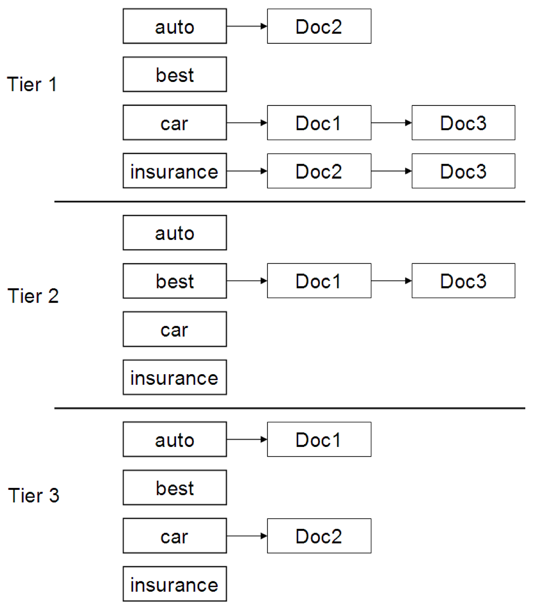

L'idea del **tiered indexes** consiste nel **partizionare** le posting list di un termine $t$ in vari **tier** (**livelli**), raggruppati per **importanza**.

Perciò quando andiamo a considerare un termine $t$ consideriamo i **tier** più importanti, scendendo di livello finché non abbiamo recuperato i $k$ documenti più importanti.

La vesione più semplice è quella con soli due strati: per ogni termine si mantengono solo due posting list:
- **high tier:** se contiene documenti più importanti per il termine
- **low tier:** se mantiene i restanti.

Cosa intendiamo per documenti **importanti?** Si torna al concetto di champion list e net-score: i documenti più importanti per un termine sono quelli con net-score più alto di una certa threshold. Una high list è simile ad una champion list.

Quando arriva una query:
1. per ogni termine si guardano le high list e si calcolano gli score dei documenti che vi appaiono;
2. se trovo più di $K$ documenti, seleziono i top-$K$ e li restituisco;
3. se invece ne trovo meno di $K$, allora passo al tier successivo e cosi via.

Per definire i **tier** possiamo usare una generica misura di **qualità** dei documenti, come per esempio il [[Query-Independent Document Scores#Net-Score|quality-score]] $g(d)$ (o qualsiasi altra misura approriata).

L'uso di tier index velocizza il recupero di documenti perché spesso i risultati migliori si trovano nei primi tier, quindi invece di attraversare tutte le posting list, ci si ferma tipicamente ad una. È chiaro che questo metodo non è safe, in quanto potremmo perdere dei documenti rilevanti che si trovano in tier più bassi.